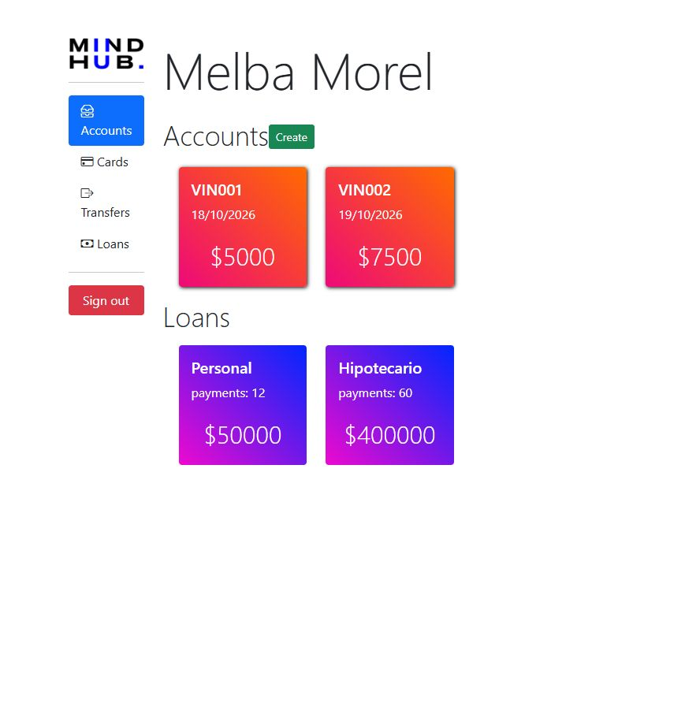
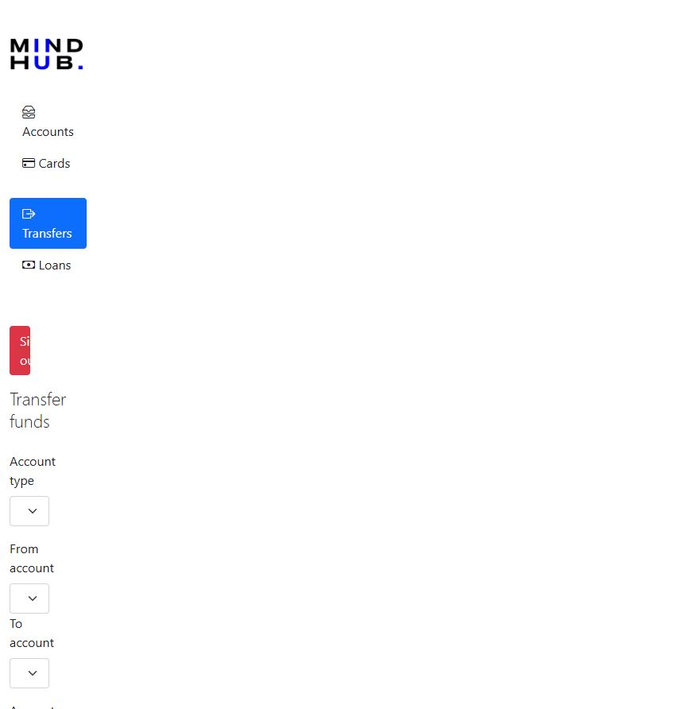
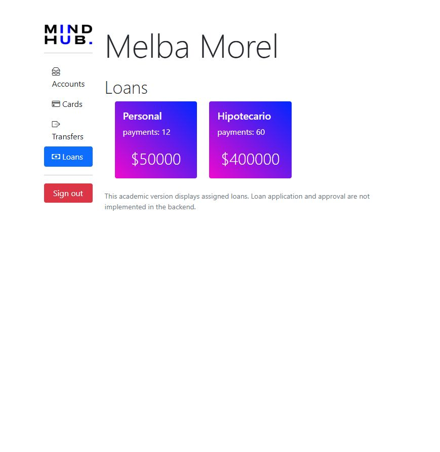

# MH HomeBanking

Aplicación académica de home banking desarrollada con Java y Spring. El proyecto permite administrar clientes, cuentas, movimientos, tarjetas y préstamos desde una interfaz web servida por el backend.

> Este proyecto es educativo y no debe utilizarse para procesar dinero real ni como base directa de una aplicación bancaria en producción.

## Funcionalidades

- Registro e inicio de sesión de clientes.
- Carga de datos de demostración al iniciar la aplicación.
- Consulta de cuentas y saldos.
- Consulta del detalle y los movimientos de una cuenta.
- Creación de nuevas cuentas.
- Transferencias entre cuentas, con validación de titularidad, saldo y monto.
- Consulta y creación de tarjetas de débito y crédito.
- Consulta de préstamos asignados al cliente.
- Endpoints REST para clientes, cuentas, tarjetas, préstamos y transacciones.
- Consola H2 disponible para inspección local con permisos restringidos.

## Tecnologías

### Backend

- Java 21 LTS.
- Spring Boot 3.5.16.
- Spring Data JPA y Hibernate.
- Spring Data REST.
- Spring Security 6, con autenticación basada en sesión.
- H2 en memoria.
- Gradle Wrapper 8.14.3.

### Frontend

El frontend está compuesto por páginas HTML, JavaScript, Vue, Axios, Bootstrap y Bootstrap Icons. Utiliza llamadas relativas a `/api`, por lo que se sirve desde la misma aplicación Spring Boot.

La interfaz base fue provista como parte de la formación académica de MindHub; no se presenta como un desarrollo original de este repositorio. Se conservaron su estructura visual y sus funcionalidades, y se agregó la vista de préstamos faltante siguiendo el estilo de las demás pantallas.

No se encontró un archivo `LICENSE` en el repositorio. Antes de reutilizar la interfaz fuera de este contexto, conviene confirmar con la academia las condiciones de uso de sus recursos gráficos, marca e interfaz.

## Capturas de la aplicación

Las siguientes capturas corresponden a la versión actual ejecutada localmente con los datos ficticios de demostración. No contienen información bancaria real.

### Inicio de sesión


### Cuentas y préstamos



### Tarjetas


### Transferencias



### Préstamos



## Requisitos para Windows

- JDK 21 instalado y disponible en `PATH`.
- Git, si se clona el repositorio.
- No es necesario instalar Gradle: se utiliza el Gradle Wrapper incluido.

Para comprobar Java:

```powershell
java -version
```

La versión debe ser 21 o compatible con el toolchain configurado en `build.gradle`.

## Ejecutar desde IntelliJ IDEA

1. Clonar el repositorio o abrir la carpeta del proyecto.
2. Seleccionar la carpeta que contiene `build.gradle` y `settings.gradle`.
3. Configurar el Project SDK como Java 21.
4. Esperar la sincronización de Gradle.
5. Ejecutar la clase:

   `src/main/java/com/mindhub/homebanking/HomebankingApplication.java`

6. Abrir [http://localhost:8080/web/index.html](http://localhost:8080/web/index.html).

También se puede ejecutar desde la terminal de IntelliJ:

```powershell
./gradlew.bat bootRun
```

## Ejecutar desde PowerShell

Desde la carpeta raíz del proyecto:

```powershell
./gradlew.bat clean test
./gradlew.bat bootRun
```

La aplicación queda disponible en:

`http://localhost:8080/web/index.html`

## Usuarios de demostración

Los usuarios se crean automáticamente en cada inicio:

| Usuario | Contraseña | Datos |
|---|---|---|
| `melba@mindhub.com` | `123456` | Cliente con cuentas, movimientos, tarjetas y préstamos |
| `admin@mindhub.com` | `admin` | Cliente con cuentas, tarjetas y préstamos |

Son credenciales ficticias incluidas únicamente para la demostración local. No deben reutilizarse en ningún entorno real.

## Prueba manual sugerida

1. Iniciar sesión con `melba@mindhub.com` y `123456`.
2. Revisar las cuentas y abrir el detalle de una cuenta para ver sus movimientos.
3. Crear una cuenta nueva.
4. Ir a transferencias y enviar un importe válido desde una cuenta propia hacia otra cuenta.
5. Confirmar que el saldo y los movimientos se actualicen.
6. Revisar las tarjetas existentes y crear una tarjeta nueva.
7. Abrir la sección Loans para consultar los préstamos asignados.
8. Cerrar sesión y comprobar que las páginas protegidas soliciten autenticación.

Al reiniciar la aplicación, H2 se recrea desde cero (`create-drop`) y se vuelve a cargar el conjunto de datos ficticios. Los cambios hechos durante una ejecución no son persistentes.

## H2 local

La consola se encuentra en:

`http://localhost:8080/h2-console`

Está protegida para el usuario con autoridad `ADMIN`. La base utilizada por la aplicación es:

```text
JDBC URL: jdbc:h2:mem:homebanking
User Name: sa
Password: (vacío)
```

La consola y las credenciales de demostración son herramientas de desarrollo local; no representan una configuración de producción.

## API principal

La autenticación usa sesión HTTP y el frontend mantiene la cookie de sesión del navegador.

- `POST /api/login`
- `POST /api/logout`
- `POST /api/clients`
- `GET /api/clients/current`
- `GET /api/clients/current/accounts`
- `POST /api/clients/current/accounts`
- `GET /api/accounts/{id}`
- `POST /api/transactions`
- `GET /api/clients/current/cards`
- `POST /api/clients/current/cards`

Además, Spring Data REST expone recursos bajo `/rest`. Las rutas administrativas y los datos de otros usuarios están protegidos por Spring Security.

## Cambios de la versión reparada

El código original utilizaba Java 11, Spring Boot 2.7.14 y Gradle 8.2.1. La rama de reparación actualizó el proyecto a:

| Componente | Original | Actual |
|---|---:|---:|
| Java | 11 | 21 LTS |
| Spring Boot | 2.7.14 | 3.5.16 |
| Gradle Wrapper | 8.2.1 | 8.14.3 |

También se realizaron estos ajustes:

- Migración de imports `javax.*` a `jakarta.*`, requerida por Spring Boot 3.
- Actualización de la configuración de Spring Security a la API moderna.
- Corrección de la consulta del detalle de cuenta y sus movimientos.
- Autorización para impedir el acceso a cuentas de otros clientes.
- Transferencias transaccionales con bloqueo pesimista y orden consistente de bloqueo.
- Uso de `BigDecimal` para importes monetarios.
- Validaciones para evitar montos inválidos, cuentas inexistentes o transferencias no autorizadas.
- Incorporación de pruebas de contexto, autenticación, autorización, movimientos, transferencias y préstamos.
- Incorporación de `loan-application.html` y su JavaScript porque los enlaces existentes apuntaban a una vista que no estaba en el repositorio.

La actualización conserva el enfoque original: una aplicación monolítica Spring Boot con frontend estático integrado. No se reemplazó el framework ni se convirtió el proyecto en una aplicación bancaria real.

## Pruebas

Ejecutar:

```powershell
./gradlew.bat test
```

Las pruebas cubren el arranque del contexto, el login, la autorización de cuentas, el uso de importes decimales, las transferencias y la carga de la vista de préstamos.

## Limitaciones conocidas

- H2 es una base en memoria: los datos se pierden al reiniciar.
- Los datos iniciales y las credenciales son fijos y están pensados para una demo.
- La aplicación no incluye recuperación de contraseña, MFA, auditoría, notificaciones ni integración con entidades financieras.
- La protección CSRF está deshabilitada para mantener el funcionamiento del frontend académico basado en sesión; esto debe rediseñarse antes de cualquier uso real.
- Los recursos visuales y CDN del frontend dependen de servicios externos y de las condiciones de uso de sus respectivos proveedores.
- No hay una licencia explícita en el repositorio.

## Estado del proyecto

Esta rama contiene una versión reparada y actualizada para ejecución local y demostración académica. No se publicó ni desplegó la aplicación desde este repositorio.
